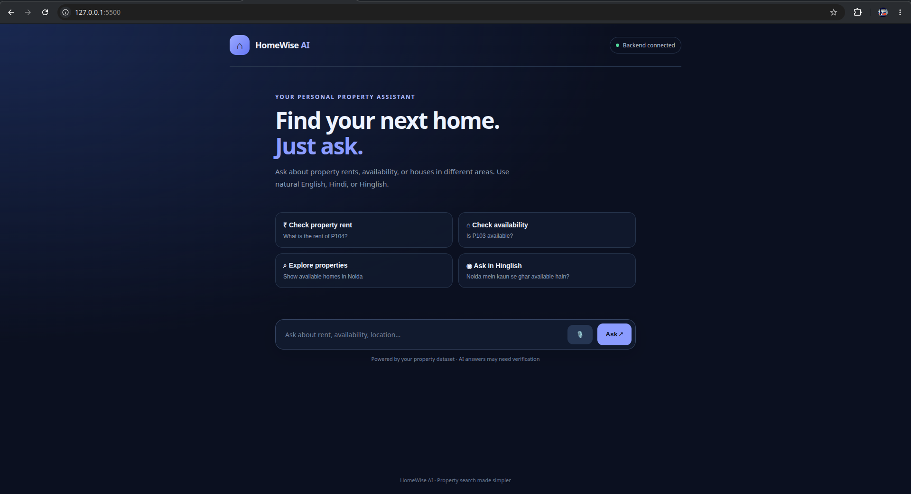

# HomeWise AI 🏠



HomeWise AI is a voice-enabled property assistant that helps users search property listings and check rent and availability using natural language.

Users can ask questions in English, Hindi, or Hinglish. The backend uses semantic similarity to identify the user's intent and retrieve relevant information from a property dataset.

## Features

- Search available properties by location.
- Check monthly rent for a property.
- Check property availability.
- Semantic intent detection using Sentence Transformers.
- Hindi and English text responses.
- Voice input using browser speech recognition.
- Voice output using browser speech synthesis.
- FastAPI backend.

## Technologies Used

- Python
- FastAPI
- Pandas
- PyTorch
- Sentence Transformers
- HTML, CSS, JavaScript
- Web Speech API

## Project Structure

```text
voice-chatbot/
├── app/
│   ├── main.py
│   └── index.html
├── data/
│   └── properties.csv
├── experiments/
│   ├── answer_question.py
│   ├── intent_examples.py
│   ├── read_dataset.py
│   ├── semantic_search.py
│   └── test_language.py
├── requirements.txt
└── README.md
```

## Installation

### 1. Clone the repository

```bash
git clone YOUR_GITHUB_REPOSITORY_URL
cd voice-chatbot
```

### 2. Create a virtual environment

```bash
python -m venv .venv
```

Activate it:

**Linux/macOS**
```bash
source .venv/bin/activate
```

**Windows**
```bash
.venv\Scripts\activate
```

### 3. Install dependencies

```bash
pip install -r requirements.txt
```

## Running the Application

### 1. Start the FastAPI backend

From the project root:

```bash
uvicorn app.main:app --reload
```

Backend address:

```text
http://127.0.0.1:8000
```

API documentation:

```text
http://127.0.0.1:8000/docs
```

### 2. Configure the frontend

Open `app/index.html`.

Find:

```javascript
const API_URL = "ENTER_YOUR_FASTAPI_URL_HERE";
```

Replace the placeholder with your own FastAPI backend URL.

For local development:

```javascript
const API_URL = "http://127.0.0.1:8000";
```

### 3. Open the frontend

Open `app/index.html` using VS Code Live Server.

The frontend will connect to your FastAPI backend.

## Sample Questions

- What is the rent of property 104?
- Is property 103 available?
- Show me available properties in Noida.
- Noida mein kaun se ghar available hain?
- Iska kiraya kitna hai?

## Dataset

The project uses a sample CSV dataset containing:

- Property ID
- Area
- Rent
- Availability

You can replace the sample records with your own property dataset using the same column names.

## Important Notes

- The Sentence Transformer model is downloaded automatically when the backend first runs.
- Users deploying the backend must host their own API.
- Users must configure their own backend URL in the frontend.
- Microphone access depends on browser permissions and speech recognition support.
- The included property records are sample data.

## License

This project is open-source and available for learning and educational purposes.
